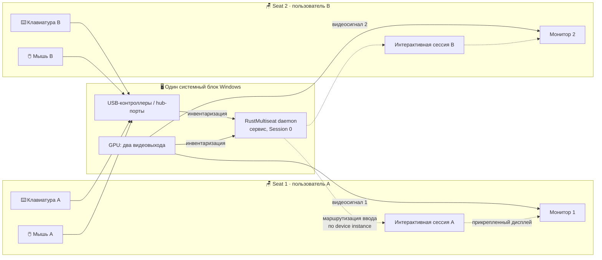
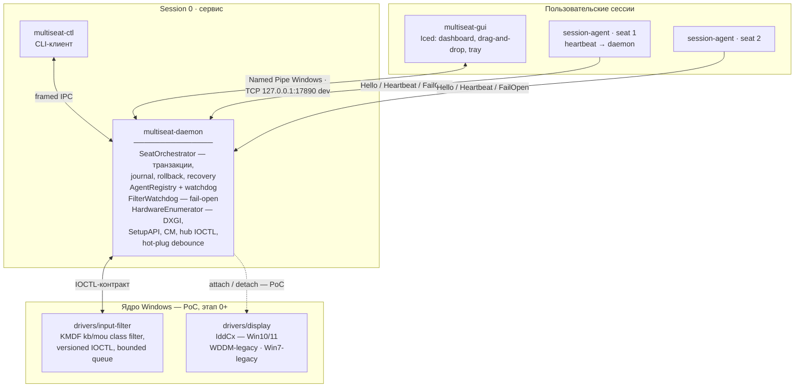
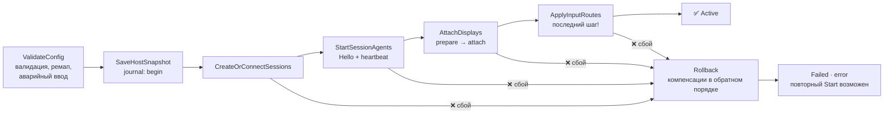
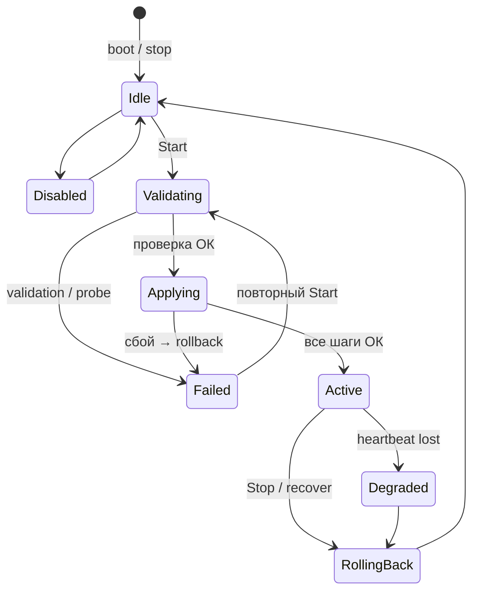
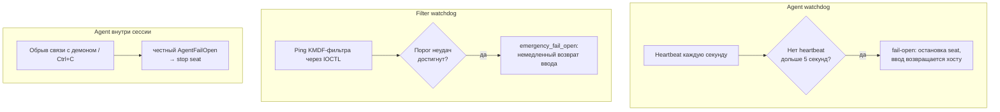

# RustMultiseat

[](https://github.com/BagmanovIlnar/RustMultiseat/actions/workflows/ci.yml)
[](LICENSE)


**Экспериментальная система multiseat для Windows на Rust**: одновременная
локальная работа нескольких пользователей за одним компьютером, где каждое
рабочее место (*seat*) получает собственные монитор, клавиатуру, мышь и
отдельную интерактивную сессию.

> [!WARNING]
> Проект находится в **исследовательской стадии**. Критический этап 0
> (доказательство двух одновременно активных локальных сессий на физическом
> стенде) ещё не пройден — все инструментальные пробы честно выдают `NO-GO`.
> До прохождения этапа 0 проект не обещает совместимость, безопасность или
> production-готовность. Детальный план исследований — в [agent.md](agent.md).

---

## Содержание

- [Идея: что такое multiseat](#идея-что-такое-multiseat)
- [Архитектура](#архитектура)
- [Как это работает](#как-это-работает)
- [Структура репозитория](#структура-репозитория)
- [Быстрый старт](#быстрый-старт)
- [Лабораторные флаги окружения](#лабораторные-флаги-окружения)
- [Тестирование](#тестирование)
- [Дорожная карта и статусы](#дорожная-карта-и-статусы)
- [Безопасность](#безопасность)
- [Лицензия](#лицензия)

---

## Идея: что такое multiseat

Обычный ПК рассчитан на одного локального пользователя. RustMultiseat
превращает один системный блок в несколько независимых рабочих мест: игрок
за одним монитором, второй пользователь — за другим, у каждого своя
клавиатура, мышь, сессия и звук — и они не мешают друг другу.



Каждое место описывается декларативной конфигурацией `SeatConfig`: пользователь
(SID), назначенные дисплеи, клавиатуры, мыши. Обязательно резервируется
**аварийный комплект ввода** (`emergency_keyboard` / `emergency_pointer`) —
хост никогда не теряет управление.

---

## Архитектура

Привилегированные операции выполняет только daemon; GUI и CLI общаются с ним
через типизированный IPC. Ядровые драйверы (PoC-стадия) изолированы от
пользовательского кода.



### Крейты workspace

| Крейт | Роль |
|---|---|
| `crates/core` | Модели (`DeviceId`, `HardwareTree`, `SeatConfig`, `MultiseatConfig`), state machine, validation, `SeatOrchestrator`, транзакционный journal, hot-plug rematch, Stage 0/7 модели |
| `crates/ipc` | Framing, Named Pipe (Windows ACL) / TCP (dev), handshake, fuzz-таргет decoder |
| `crates/platform-windows` | WinAPI-слой: DXGI, SetupAPI, Configuration Manager, USB hub IOCTL, WTS, `RegisterDeviceNotification`; mock-бэкенды с fault-инъекциями |
| `crates/daemon` | Windows-сервис (SCM), IPC-сервер, watchdog-и, durable journal/config, CLI `multiseat-ctl` |
| `crates/session-agent` | Агент в целевой сессии: heartbeat, честный fail-open по обрыву |
| `crates/gui` | Iced-конфигуратор: drag-and-drop привязка устройств, validation preview, tray |

---

## Как это работает

### 1. Инвентаризация железа

Демон строит согласованную «фотографию» железа (`HardwareTree`, монотонная
`revision`): GPU и выходы через **DXGI**, устройства и интерфейсы через
**SetupAPI + Configuration Manager**, USB-топологию через **hub/port IOCTL**.
Идентификаторы устройств стабильны (instance ID + interface path + container
ID) и переживают hot-plug: событие `RegisterDeviceNotification` только
инвалидирует snapshot, повторное сканирование выполняется после **debounce**,
а конфиг ремапится по `same_device` / `same_container`.

### 2. Транзакционный запуск (этап 5 — реализован)

Запуск места — транзакция с durable journal: любой сбой на середине
разворачивает шаги **в обратном порядке**.



Откат идёт в порядке, обратном журналу: сначала маршруты ввода, затем
дисплеи (detach + rollback token), затем сессии (lock + disconnect). Прошёл
crash между шагами? При старте демон читает durable journal и выполняет
`recover()`: незавершённые журналы откатываются, завершённые — чисто
останавливаются с возвратом ввода хосту.

### 3. Машина состояний



`Active` запрещён, если heartbeat любого обязательного backend'а отсутствует.

### 4. IPC-протокол

Named Pipe `\\.\pipe\RustMultiseatDaemon` (Windows; локальный ACL по SID
службы/Administrators/пользователя) или TCP `127.0.0.1:17890` на dev-хостах
(`MULTISEAT_IPC=tcp`).

```text
┌─────────┬──────────────────┬──────────────┬───────┬────────────┬───────────────┬─────────┐
│  magic  │ protocol_version │ message_kind │ flags │ request_id │ payload_length│ payload │
└─────────┴──────────────────┴──────────────┴───────┴────────────┴───────────────┴─────────┘
   little-endian · лимит размера frame · handshake версии до команд ·
   timeout 5s · backpressure · fuzz-покрытие decoder
```

Команды (`ClientRequest`): `Hello`, `GetSnapshot`, `ValidateConfig`,
`SaveConfig`, `Start`, `Stop`, `Subscribe`, `AcknowledgeEmergency`, плюс
агентские `AgentHello` / `AgentHeartbeat` / `AgentFailOpen`. Демон пушит
события (`DaemonEvent`): изменение железа, состояния seat, прогресс операции,
диагностика.

### 5. Watchdog и fail-open — главный инвариант безопасности

**Хост никогда не должен терять управление.** Три независимых сторожа:



Если сервис упал целиком — input-filter сам переходит в fail-open по таймауту
heartbeat; аварийные клавиатура и мышь, зарезервированные в конфиге, остаются
у хоста всегда. Поведение покрыто fault-injection тестами (см. ниже).

### 6. GUI (этап 6 — реализован)

Конфигуратор на Iced: дерево железа слева, seats справа. Привязка устройств —
**pointer drag-and-drop**: нажатие на устройстве начинает drag, прозрачный
canvas-слой рисует бейдж у курсора, drop-зоны подсвечиваются, отпускание над
seat'ом меняет **только локальный draft** (`Esc` — отмена). Затем — локальный
preview-validation и валидация демоном (`Validate`/`Start`). Плюс: tray
(hide-on-close), панели Validation/Feasibility (Stage 0 чеклист), live-обновления
по подписке.

---

## Структура репозитория

```text
RustMultiseat/
├── crates/
│   ├── core/                 # модели, state machine, orchestrator, journal
│   ├── ipc/                  # framing, Named Pipe / TCP transport
│   ├── platform-windows/     # WinAPI + mock-бэкенды (fault-инъекции)
│   ├── daemon/               # сервис, IPC-сервер, watchdog-и, ctl
│   ├── session-agent/        # агент пользовательской сессии
│   └── gui/                  # Iced-конфигуратор (DnD, tray)
├── drivers/
│   ├── input-filter/         # KMDF C-PoC: kb/mou class filter + IOCTL + INF
│   ├── virtual-input/        # исследование (README)
│   └── display/              # iddcx / wddm-legacy / win7-legacy (README)
├── installer/                # install-plan по OsGeneration, чеклисты подписи
├── scripts/                  # e2e smoke, stage0 lab checklist, win7 build-std
├── fuzz/                     # cargo-fuzz: IPC decoder
├── tests/integration/        # (расширяется)
└── agent.md                  # детальный план исследований и требования
```

---

## Быстрый старт

Требуется Rust `1.99.0` (см. `rust-toolchain.toml`). Всё, кроме нативных
WinAPI-проб, работает на любом dev-хосте (macOS/Linux/Windows) —
non-Windows хосты автоматически используют mock-бэкенды и TCP-транспорт.

```bash
# Сборка
cargo build --workspace

# Тесты (unit + integration + fault-injection; 146+)
cargo test --workspace

# 1) Поднять демон (dev: TCP 127.0.0.1:17890; Windows: Named Pipe)
cargo run -p multiseat-daemon --bin multiseat-daemon

# 2) CLI-клиент в другом терминале
cargo run -p multiseat-daemon --bin multiseat-ctl -- snapshot
cargo run -p multiseat-daemon --bin multiseat-ctl -- validate-sample
cargo run -p multiseat-daemon --bin multiseat-ctl -- start-sample
cargo run -p multiseat-daemon --bin multiseat-ctl -- stop
cargo run -p multiseat-daemon --bin multiseat-ctl -- lab-report
cargo run -p multiseat-daemon --bin multiseat-ctl -- native-status

# 3) GUI (drag-and-drop конфигуратор)
cargo run -p multiseat-gui

# E2E smoke целиком
bash scripts/mock_e2e_smoke.sh --with-agent
```

### Windows-сервис (на Windows-хосте)

```powershell
# установка (требует elevation)
multiseat-daemon.exe --install --auto-start
# запуск через SCM / services.msc, имя службы: RustMultiseat
multiseat-daemon.exe --uninstall
```

### Сборка под Windows 7 (эксперимент `x86_64-win7-windows-msvc`)

```bash
scripts/win7_buildstd_check.sh          # cargo check с -Z build-std (любой хост)
scripts/win7_buildstd_check.sh --build  # release .exe — только Windows + MSVC
```

CI-эксперимент: job `win7-buildstd` (pinned `nightly-2026-10-29` + rust-src,
проверка нижней границы PE-импортов, артефакты `.exe`).

---

## Лабораторные флаги окружения

| Переменная | Назначение |
|---|---|
| `MULTISEAT_IPC=tcp` | форсировать TCP-транспорт вместо Named Pipe |
| `MULTISEAT_USE_MOCK` | mock-инвентаризация на Windows-хосте |
| `MULTISEAT_REQUIRE_AGENT=1` | start_agent падает, если бинарник агента недоступен |
| `MULTISEAT_NATIVE_AGENT_LAUNCH=1` | запуск агента через `CreateProcessAsUser` + WTS-токен |
| `MULTISEAT_NATIVE_SESSION_CONTROL=1` | нативные lock/disconnect (`WTSDisconnectSession`) |
| `MULTISEAT_DISPLAY_BACKEND` / `MULTISEAT_DISPLAY_ATTACH=1` | выбор display-backend / soft bookkeeping attach |
| `MULTISEAT_INPUT_FILTER=1` / `MULTISEAT_INPUT_SOFT_APPLY=1` | soft-режимы input-фильтра для лаборатории |
| `MULTISEAT_INPUT_FILTER_HEARTBEAT_FAIL=1` / `MULTISEAT_INPUT_FILTER_FAIL_THRESHOLD` | инъекция нездоровья фильтра (crash-лаба) |
| `MULTISEAT_MOCK_FAIL_STAGE=…` | fault-инъекция: `session_create` / `agent_start` / `display_prepare` / `display_attach` / `input_apply` |
| `MULTISEAT_AGENT_TIMEOUT_MS` / `MULTISEAT_AGENT_HEARTBEAT_MS` | тайминги agent-watchdog |

---

## Тестирование

- **Unit** (core/ipc/daemon/gui): модели, validation, state transitions,
  rollback-порядок, framing, DnD-геометрия;
- **Fuzz**: IPC decoder (`fuzz/fuzz_targets/decode_frame.rs`);
- **Integration** (`crates/daemon/tests/`): daemon↔client roundtrip, snapshot,
  hot-plug rematch, journal recovery, agent hello/heartbeat/fail-open,
  watchdog-и;
- **Fault-injection** (`fault_injection.rs`): **corrupted journal** (мусор /
  обрезка / чужая schema-версия → безопасный бут), **partial apply** на каждой
  из 5 стадий транзакции через IPC (сбой → `Failed` → retry → `Active`),
  **обрыв клиента** во время `Active`, **IPC timeout** против молчащего пира;
- **Smoke-скрипты**: `mock_e2e_smoke.sh`, `stage0_lab_checklist.sh`
  (пишет NO-GO артефакт до прохождения этапа 0);
- **Hardware lab** (план §10): физический стенд — обязательная часть для
  этапов 0/4/7.

---

## Дорожная карта и статусы

| Этап | Содержание | Статус |
|---|---|---|
| **0. Feasibility PoC** | 2 активные сессии + дисплей + ввод на стенде, go/no-go | ❌ **не реализован — главный блокер** |
| **1. Workspace, CI, core** | модели/traits/CI; win7-target эксперимент | 🟡 частично (CI-job `win7-buildstd` — эксперимент) |
| **2. IPC и Windows Service** | framing, ACL, handshake, fuzz, SCM, journal | ✅ реализован |
| **3. Hardware inventory** | DXGI/SetupAPI/CM/hub IOCTL, hot-plug debounce | ✅ реализован (сверка на железе — лаб.) |
| **4. Session/input/display backends** | native launch, KMDF-фильтр PoC, display PoC | 🟡 частично (display-драйверы — за этапом 0) |
| **5. Orchestrator** | транзакции, rollback, recovery, fault-инъекции | ✅ реализован |
| **6. GUI и tray** | dashboard, pointer DnD, preview, tray | ✅ реализован (legacy-рендер Win7/8 — отдельно) |
| **7. Installer и release** | install-plan, подпись WHCP/HCK, rollback | 🟡 частично (план генерируется; пакет — за этапом 0) |

Go-критерии этапа 0: две сессии ≥ 8 часов, нет перекрёстного ввода, rollback
работает после сбоя каждого шага, Secure Boot не отключается, определён
лицензируемый способ подписи. Если критерии не проходят — направления:
Windows Server/RDS, VM на seat, общий desktop без изоляции.

---

## Безопасность

- Все привилегированные операции — только в daemon (Session 0); GUI не имеет
  доступа к driver handles и service credentials;
- IPC: локальный ACL по SID, проверка token/impersonation для привилегированных
  команд, запрет удалённых клиентов;
- Input-filter: bounded nonpaged queue, fail-open при heartbeat timeout /
  crash службы / переполнении; **release не логирует scan codes и текст ввода**
  (риск keylogging);
- Secure Desktop / UAC / Ctrl+Alt+Del — защищённый путь ввода не обходится;
- Драйверы в release — только через WHCP/HCK-подпись; Test Signing — лаборатория.

---

## Лицензия

[MIT](LICENSE) © BagmanovIlnar

Подробный план исследований, ограничения и источники требований:
[agent.md](agent.md).
