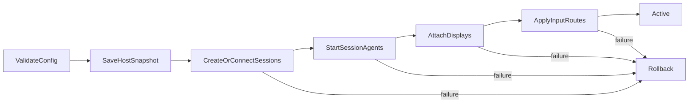

# План разработки RustMultiseat

## 1. Цель и границы проекта

RustMultiseat — экспериментальная система для одновременной локальной работы
нескольких пользователей на одном компьютере. Каждое рабочее место (`seat`)
должно получить:

- отдельную интерактивную Windows-сессию и пользователя;
- назначенный монитор или видеовыход;
- отдельные клавиатуру и мышь;
- независимые звук и USB-устройства на последующих этапах.

Целевые системы: Windows 7 SP1, Windows 8, Windows 8.1, Windows 10 и Windows
11, в первую очередь x86-64. Основной компилятор пользовательских компонентов:
`rustc 1.99.0 (b940084d7 2026-09-28)`.

### Критическое ограничение

Клиентские редакции Windows штатно не предоставляют несколько одновременно
активных локальных интерактивных сессий. Создание процесса в другой сессии,
виртуальный HID или виртуальный монитор сами по себе не делают эту сессию
локально интерактивной. Windows также не предоставляет документированного API,
который связывает произвольную физическую клавиатуру, мышь или монитор с
конкретной локальной сессией.

Поэтому проект является исследовательским. Этап 0 должен доказать возможность
работы на каждой поддерживаемой версии Windows. Пока этот этап не пройден,
нельзя обещать совместимость, безопасность, конкретную частоту кадров или
выпуск production-драйверов. Следует также отдельно проверить лицензионные
условия Microsoft для одновременных интерактивных сессий.

## 2. Матрица совместимости

| Компонент | Windows 7 SP1 | Windows 8/8.1 | Windows 10 | Windows 11 |
|---|---|---|---|---|
| Пользовательские Rust-компоненты | Специальный Win7 target/sysroot | Win7 target как общий нижний уровень | Стандартный MSVC target | Стандартный MSVC target |
| Обнаружение USB/HID | SetupAPI + Configuration Manager | То же | То же | То же |
| Обнаружение GPU/выходов | DXGI 1.1 с runtime-проверками | DXGI с runtime-проверками | DXGI | DXGI |
| Виртуальный дисплей | Отдельный legacy PoC | Отдельный WDDM PoC | IddCx, начиная с Windows 10 1607 | IddCx |
| Маршрутизация HID | Отдельный KMDF PoC | Отдельный KMDF PoC | KMDF PoC | KMDF PoC |
| Подпись release-драйвера | WHCP/HCK | WHCP/HCK | WHCP или актуальный Microsoft signing flow | WHCP или актуальный Microsoft signing flow |

### Ограничения Rust 1.99.0

- Обычный target `x86_64-pc-windows-msvc` рассчитан на современную Windows и не
  должен считаться совместимым с Windows 7.
- Для Windows 7 используется Tier 3 target
  `x86_64-win7-windows-msvc`. Готовый standard library/sysroot для него не
  гарантирован и может не распространяться через `rustup`.
- Варианты сборки legacy-артефактов: собственная сборка Rust/sysroot либо
  nightly-toolchain с `-Z build-std`. Флаг `-Z` нельзя считать доступным в
  обычном stable `cargo 1.99.0`, поэтому способ фиксируется только после
  воспроизводимого CI-эксперимента.
- Windows 8/8.1 разумно собирать тем же target с нижней границей Windows 7,
  если все зависимости действительно поддерживают эти ОС.
- Для каждого crate проверяются не только MSRV, но и минимальная версия Windows,
  импортируемые DLL/API и отсутствие безусловных вызовов новых WinAPI.
- Драйверы собираются отдельно от пользовательских приложений: `#![no_std]`,
  запрет unwind, контролируемый allocator, WDK headers/libs и явные правила для
  IRQL. Наличие Rust bindings не означает готовность безопасного WDF-фреймворка.
- Версии Rust, Cargo, WDK, SDK, LLVM/linker и всех crates закрепляются. Ветки
  `main` зависимостей в воспроизводимой сборке не используются.

## 3. Структура Cargo Workspace

```text
rust-multiseat/
├── Cargo.toml
├── rust-toolchain.toml
├── crates/
│   ├── core/                    # Модели, состояния и IPC-контракты
│   ├── ipc/                     # Framing, Named Pipe client/server, ACL
│   ├── platform-windows/        # WinAPI и определение возможностей ОС
│   ├── daemon/                  # Windows Service и оркестрация
│   ├── session-agent/           # Агент внутри пользовательской сессии
│   └── gui/                     # Конфигуратор на Iced
├── drivers/
│   ├── input-filter/            # Фильтрация физических HID-пакетов
│   ├── virtual-input/           # Экспериментальный virtual HID
│   └── display/
│       ├── iddcx/               # Только Windows 10/11
│       ├── wddm-legacy/         # Исследование Windows 8/8.1
│       └── win7-legacy/         # Исследование Windows 7
├── installer/                   # Установка, подпись, rollback/recovery
└── tests/
    ├── integration/
    └── hardware-lab/
```

`gui` не зависит от драйверов. Все привилегированные операции выполняет
`daemon`; GUI отправляет ему только типизированные команды. `session-agent`
работает в целевой пользовательской сессии и не получает права LocalSystem.

## 4. Модели и интерфейсы `core`

Не следует создавать отдельный класс для каждой операции. Модели хранят данные,
traits изолируют только реально заменяемые платформенные механизмы, а
`SeatOrchestrator` координирует один сценарий запуска/остановки.

### Структуры данных

#### `DeviceId`

Стабильный идентификатор устройства: instance ID, interface path и, где
доступно, container ID. Нельзя использовать только порядковый номер DXGI или
сырой handle: они меняются после перезагрузки и hot-plug.

#### `HardwareTree`

Свойства:

- `revision: u64` — монотонная ревизия снимка;
- `gpus: Vec<GpuInfo>`;
- `displays: Vec<DisplayInfo>`;
- `usb_roots: Vec<UsbNode>`;
- `input_devices: Vec<InputDeviceInfo>`;
- `capabilities: PlatformCapabilities`.

#### `SeatConfig`

Свойства:

- `id: SeatId`;
- `user_sid: UserSid`;
- `display_ids: Vec<DisplayId>`;
- `keyboard_ids: Vec<DeviceId>`;
- `pointer_ids: Vec<DeviceId>`;
- `enabled: bool`.

Конфигурация обязана сохранять хотя бы один аварийный комплект ввода для
управления хостом.

#### `SeatState`

Состояния:

- `Disabled`;
- `Idle`;
- `Validating`;
- `Applying`;
- `Active`;
- `Degraded { reason }`;
- `RollingBack`;
- `Failed { error }`.

#### IPC enums

- `ClientRequest`: `Hello`, `GetSnapshot`, `ValidateConfig`, `SaveConfig`,
  `Start`, `Stop`, `Subscribe`, `AcknowledgeEmergency`;
- `ServerResponse`: ответ с тем же `request_id`;
- `DaemonEvent`: изменение оборудования, состояния места, прогресс операции и
  диагностическое предупреждение;
- `ProtocolError`: несовместимая версия, слишком большой frame,
  неавторизованный клиент, некорректная команда или поврежденные данные.

### Traits

#### `HardwareEnumerator`

- `capabilities()` — возвращает реально доступные функции текущей ОС;
- `snapshot()` — строит согласованный снимок оборудования;
- `start_notifications()` — запускает уведомления, после которых выполняется
  debounced rescan, а не частичное ручное изменение дерева.

#### `InputRouter`

- `validate(assignments)` — проверяет существование устройств, конфликты и
  наличие аварийного ввода;
- `apply(assignments)` — атомарно подготавливает маршруты или возвращает
  rollback token;
- `rollback(token)` — отменяет частично примененные маршруты;
- `health()` — сообщает о heartbeat драйвера, потерянных устройствах и
  переполнении очередей.

Этот интерфейс не предполагает, что `SendInput` решает задачу. `SendInput`
вставляет события в общий input stream, ограничен UIPI и не направляет
физическое устройство в произвольную сессию.

#### `DisplayBackend`

- `capabilities()` — сообщает поддерживаемые модели дисплея для данной ОС;
- `prepare(seats)` — проверяет доступные адаптеры, выходы и режимы;
- `attach(seat, session)` — экспериментально связывает вывод с сессией;
- `detach(seat)` — удаляет связь;
- `rollback(token)` — восстанавливает исходную display configuration.

IddCx создает indirect display, но сам по себе не связывает его с отдельной
локальной интерактивной сессией. Это является предметом PoC, а не готовым
решением.

#### `SessionBackend`

- `probe()` — проверяет, допускает ли система нужную модель сессий;
- `create_or_connect(seat)` — создает или подключает целевую сессию;
- `start_agent(session)` — запускает `session-agent` с минимальным token;
- `lock(session)` и `disconnect(session)` — управляют жизненным циклом;
- `health(session)` — проверяет состояние сессии и агента.

Документированные WTS API используются для перечисления и наблюдения. На
клиентской Windows они не гарантируют несколько одновременно активных
локальных сессий. Любой недокументированный backend изолируется в отдельной
реализации и отключается по умолчанию.

## 5. Windows platform layer

### Обнаружение оборудования

- GPU и физические outputs: DXGI (`IDXGIFactory1`, adapters, outputs).
- Device instance/interface: SetupAPI и Configuration Manager.
- USB-топология: hub/port IOCTL плюс связи devnode. Цепочка `CM_Get_Parent` не
  всегда дает полную семантику физического USB-порта, поэтому результат
  проверяется по hub IOCTL и location paths.
- HID: usage page/usage, VID/PID, serial/container ID и соответствующий
  keyboard/mouse interface.
- Hot-plug: `RegisterDeviceNotification` для service handle с fallback по
  версии ОС. Событие только инвалидирует snapshot; повторное сканирование
  выполняется после debounce.

### Windows Service

Служба работает в Session 0 под отдельной service identity или LocalSystem
только там, где это действительно требуется. Интерактивный UI из службы не
показывается.

`WindowsServiceHost`:

- `install()`/`uninstall()` — отдельные installer-команды, не обычный runtime;
- `run()` — регистрирует service control handler и запускает runtime;
- `handle_control()` — обрабатывает stop, shutdown и device events;
- `shutdown()` — сначала переводит input filters в fail-open, затем завершает
  agents и IPC.

### IPC через Named Pipes

Named Pipes выбираются для локальной аутентификации и работы между Session 0 и
пользовательскими сессиями, а не из-за недоказанного преимущества скорости.

Формат frame:

```text
magic | protocol_version | message_kind | flags | request_id | payload_length | payload
```

Требования:

- фиксированный little-endian config сериализатора;
- максимальный размер frame и лимит очереди;
- timeout, cancellation и backpressure;
- handshake версии до приема команд;
- явный ACL по SID службы, Administrators и активного пользователя;
- запрет удаленных клиентов там, где API ОС это поддерживает, и строгий ACL на
  Windows 7;
- проверка token/impersonation клиента для привилегированных команд;
- fuzz-тестирование decoder.

`bincode` допустим только внутри payload после фиксации версии и настроек. Он не
гарантирует нулевые аллокации и не является самодостаточным стабильным
сетевым протоколом. Изменение порядка enum/полей требует новой версии
протокола.

## 6. Драйверы и безопасность

### Input filter

PoC начинается с документированных Kbfiltr/Moufiltr patterns. PS/2 и USB HID
имеют разные device stacks; нельзя считать PS/2 sample готовым общим HID
фильтром.

Обязанности:

- однозначно сопоставить пакет с device instance;
- передать пакет в bounded nonpaged queue;
- подавить пакет в системном class input только после подтверждения рабочего
  маршрута;
- при heartbeat timeout, crash службы, ошибке конфигурации или переполнении
  перейти в fail-open;
- не выполнять блокирующие операции и allocation на неподходящем IRQL;
- предоставить минимальный versioned IOCTL-контракт с проверкой размеров.

`InputFilterDevice`:

- `on_connect()` — сохраняет исходный class callback;
- `on_input()` — маршрутизирует или пропускает пакет;
- `set_routes()` — атомарно заменяет проверенную таблицу маршрутов;
- `set_fail_open()` — немедленно возвращает ввод хосту;
- `query_stats()` — отдает счетчики без чувствительного содержимого ввода.

Перехват нажатий создает риск keylogging. Release-сборка не логирует scan codes,
текст или пароли. Secure Desktop, Ctrl+Alt+Del, UAC и экран входа проверяются
отдельно; обход защищенного пути ввода не является допустимым решением.

### Virtual input

Virtual HID может создать отдельное устройство, но это еще не маршрутизация в
конкретную Windows-сессию. Этап 0 сравнивает минимум три варианта:

1. документированный virtual HID + session agent;
2. допустимый RDP/remote-session input path;
3. изолированный экспериментальный backend.

Вариант принимается только если он работает одновременно в двух сессиях, не
нарушает Secure Desktop и восстанавливается после аварии.

### Display backends

- **Windows 10 1607–1709:** отдельная IddCx 1.0 сборка.
- **Windows 10 1803+ и Windows 11:** отдельная современная IddCx сборка с
  runtime-проверками доступности DDI.
- **Windows 8/8.1:** исследовательский WDDM display-only miniport PoC.
  Desktop Duplication только захватывает существующий desktop и не создает
  независимый монитор.
- **Windows 7:** отдельный legacy PoC. Mirror driver зеркалирует содержимое, но
  не считается доказательством независимого seat.

Нельзя собирать один «универсальный IddCx-драйвер» для Windows 7–11: IddCx
появился только в Windows 10. Display driver на Rust допускается лишь после
минимального C/C++ WDK reference prototype и сравнения поведения; при
недостаточной зрелости Rust bindings production-драйвер остается на C/C++, а
остальная система — на Rust.

## 7. `SeatOrchestrator` и транзакционный запуск

`SeatOrchestrator` хранит ссылки на четыре интерфейса:
`HardwareEnumerator`, `SessionBackend`, `DisplayBackend`, `InputRouter`.
Новых manager-классов для каждой команды не требуется.

Методы:

- `validate_config(config)` — проверяет уникальность назначений, поддержку ОС,
  пользователей, аварийный ввод и recovery policy;
- `start(config)` — сохраняет исходное состояние, поднимает сессии и agents,
  подготавливает displays, последним включает подавление/маршрутизацию ввода;
- `stop()` — первым возвращает физический ввод хосту, затем отключает displays
  и sessions;
- `rollback(journal)` — выполняет компенсирующие действия в обратном порядке;
- `recover()` — после рестарта читает durable journal и возвращает систему в
  безопасное состояние.

Последовательность запуска:



Изменение конфигурации во время `Active` сначала валидируется и применяется как
новая транзакция. Конфигурация не меняется непосредственно из GUI.

## 8. GUI на Iced

### Зависимости и совместимость

- Используется конкретный release Iced, а не ветка `main`.
- API (`Task` либо `Command`, theme/style API) выбирается по закрепленной
  версии; смешивать примеры разных версий нельзя.
- `wgpu` используется на Windows 10/11 после проверки адаптера.
- `tiny-skia` является обязательным software fallback и главным кандидатом для
  Windows 7/8/8.1. Сам факт наличия fallback не доказывает поддержку этих ОС:
  отдельно проверяются Iced, winit и tray dependencies.
- Если современный Iced/winit не запускается на legacy Windows, GUI для этих
  систем выносится в простой Win32 frontend. Демон и протокол остаются общими.

### Модель приложения

`MultiseatApp`:

- `hardware: HardwareTree`;
- `draft: Vec<SeatConfig>`;
- `daemon_state: ConnectionState`;
- `operation: Option<OperationProgress>`;
- `drag: Option<DragState>`;
- `validation: Vec<ValidationIssue>`.

Методы:

- `new()` — создает модель и запускает подключение;
- `update(message)` — меняет только модель и возвращает async task;
- `subscription()` — объединяет IPC events, timer/reconnect и tray events;
- `view()` — строит дерево устройств, seats и diagnostics;
- `theme()` — возвращает тему без платформенной логики.

`GuiMessage` включает `Connected`, `Disconnected`, `SnapshotReceived`,
`DaemonEventReceived`, `DragStarted`, `PointerMoved`, `Dropped`, `Validate`,
`Start`, `Stop`, `TrayEvent` и результаты async-команд.

### Drag-and-drop и tray

У Iced нет общего встроенного API `on_drag/on_drop` для произвольных виджетов.
Внутренний DnD реализуется как один custom widget или через обработку pointer
events:

- hit-testing источника и seat drop-zone;
- pointer capture/состояние drag;
- визуальный preview;
- drop меняет только `draft`, после чего демон выполняет validation.

Статус: ✅ реализовано. Нажатие на устройстве в списке Hardware запускает
 drag-сессию (`mouse_area` обеспечивает hit-testing источников и зон);
 pointer-capture/состояние живет в `DragState`; поверх дашборда лежит
 прозрачный canvas-слой `DragPreview` (бейдж с устройством у курсора +
 отмена по Escape); drop меняет только `draft` с локальным
 preview-validation и последующей валидацией демона (Validate/Start).
 Режим «клик — потом клик по зоне» сохранён как альтернатива; Esc и кнопка
 Cancel прерывают drag. Это не то же самое, что системный file
drag-and-drop.

Нельзя заранее утверждать, что tray event loop безопасно работает в отдельном
потоке. Сначала проверяются ограничения закрепленных версий `iced`, `winit`,
`tray-icon` и `muda`. Предпочтителен один Windows event loop с передачей событий
через event proxy/channel. Закрытие окна скрывает его только после
пользовательской настройки; команда «Выход» остается доступной.

IPC никогда не блокирует `update()`. GUI показывает состояние запроса и
использует timeout/reconnect с ограниченным exponential backoff.

## 9. Этапы реализации

Статусы ниже отмечают текущее состояние кодовой базы:

- ✅ — реализовано и покрыто тестами;
- 🟡 — частично (основное есть, перечислены пробелы);
- ❌ — не реализовано.

### Этап 0. Feasibility PoC — обязательный go/no-go

Статус: ❌ не реализован. Go-критерии не пройдены; checkpoint-модели
(`feasibility.rs`), WTS/display/input-пробы и `ctl lab-checklist` оформлены
как tooling-smoke и на всех стендах честно выдают NO-GO. Физического
доказательства двух одновременно активных локальных сессий нет.

Порядок экспериментов:

1. На физическом стенде получить две одновременно активные интерактивные
   сессии на каждой целевой Windows.
2. Показать каждой сессии независимое динамическое содержимое на назначенном
   физическом/виртуальном дисплее.
3. Отличить два комплекта клавиатура+мышь по device instance.
4. Подавить ввод каждого комплекта в чужих сессиях и доставить его только
   целевой сессии.
5. Проверить login, lock/unlock, UAC/Secure Desktop, Ctrl+Alt+Del, sleep/resume,
   Fast User Switching, hot-plug и смену разрешения.
6. Имитировать crash службы/agent/driver channel и подтвердить возврат
   аварийной клавиатуры и мыши хосту не позднее заданного timeout.

Go-критерии:

- две сессии работают одновременно не менее 8 часов;
- нет перекрестного ввода и потери аварийного управления;
- rollback восстанавливает исходную конфигурацию после ошибки каждого шага;
- подход не требует отключения Secure Boot, Test Signing или защитного пути
  ввода в release-режиме;
- определен поддерживаемый и лицензируемый способ установки/подписи.

Если хотя бы один базовый критерий не выполняется, дальнейшая разработка
production GUI и драйверов останавливается. Допустимые новые направления:
Windows Server/RDS, отдельная VM на seat или multiseat в одном общем desktop без
изоляции пользователей.

### Этап 1. Workspace, CI и core

Статус: 🟡 частично. Реализованы: workspace, закрепленный toolchain/lockfile,
модели, traits, state machine, validation, orchestrator, remap, unit-тесты;
CI (fmt/clippy/test на ubuntu/windows/macos). Не реализовано: CI-матрица
Windows 7/8.1 и воспроизводимый эксперимент со сборкой под
`x86_64-win7-windows-msvc` (build-std), проверка минимальных OS imports
бинарников.

- Зафиксировать toolchains и lockfile.
- Реализовать модели, traits, state machine и unit-тесты.
- Поднять CI-матрицу Windows 7/8.1/10/11; для EOL-систем использовать
  изолированные self-hosted runners без доступа из недоверенных PR.
- Проверить минимальные OS imports готовых бинарников.

### Этап 2. IPC и Windows Service

Статус: ✅ реализован. Framing/handshake/ACL-модель, Named Pipe (Windows) с
TCP-fallback для dev, mock-daemon, CLI-клиент `ctl`, fuzz-таргет decoder,
SCM-хост службы, persistence и recovery journal.

- Реализовать framing, ACL, handshake и fuzz target.
- Сделать mock-daemon и CLI-клиент до GUI.
- Реализовать install/start/stop/recovery journal.

### Этап 3. Hardware inventory

Статус: ✅ реализован (в коде). DXGI, SetupAPI, Configuration Manager, hub
IOCTL, hot-plug debounce, стабильные идентификаторы и hot-plug rematch
покрыты тестами на mock/lab-наборах. Не завершена сверка с Device Manager и
USBView на физическом железе (лабораторный пункт, требует стенда).

- Реализовать DXGI, SetupAPI, Configuration Manager и hub IOCTL.
- Добавить hot-plug debounce и стабильные идентификаторы.
- Сверить snapshot с Device Manager и USBView на тестовом железе.

### Этап 4. Session, input и display backends

Статус: 🟡 частично. Session: CreateProcessAsUser + WTS lock/disconnect за
нативными флагами, watchdog агентов с fail-open. Input: KMDF C-PoC
(`drivers/input-filter`), IOCTL-контракт, watchdog/fail-open и soft E2E в
демоне; полная маршрутизация в целевые сессии не доказана (Стадия 0).
Display: только probe + soft bookkeeping attach; IddCx/WDDM-legacy/win7-legacy
драйверы не начаты (только README). Virtual-input: исследовательский README,
сравнение вариантов не проводилось.

- Реализовывать только backend, успешно доказанный на этапе 0.
- Начать с минимального reference driver и Driver Verifier.
- Добавить watchdog/fail-open до функций подавления ввода.
- Разделить driver packages по поколениям Windows.

### Этап 5. Orchestrator

Статус: ✅ реализован (на mock/soft backends). validate/start/stop/rollback/
recover, транзакционный журнал, запрет `Active` без heartbeat; fault-пути
покрыты юнит-тестами (сбой на каждом шаге + порядок компенсаций) и
fault-injection интеграционными тестами через IPC.

- Реализовать validation, transaction journal, start/stop/rollback/recover.
- Проверить fault injection на каждом переходе.
- Запретить `Active`, если heartbeat любого обязательного backend отсутствует.

### Этап 6. GUI и tray

Статус: ✅ реализовано (без legacy-части). Dashboard, pointer-DnD с canvas
preview и Esc-отменой, click-режим, локальный preview-validation, панели
Validation/Feasibility, tray (hide-on-close + Show/Exit), IPC без блокировки
update. Не проводился: отдельный legacy renderer/event-loop PoC для
Windows 7/8.1 (tiny-skia/Win32 frontend).

- Сначала подключить GUI к mock-daemon.
- Реализовать dashboard, DnD, validation и diagnostics.
- Провести отдельный legacy renderer/event-loop PoC.
- Не давать GUI прямого доступа к driver handles или service credentials.

### Этап 7. Installer и release

Статус: 🟡 частично. Есть: генерация install-plan по OsGeneration, signing
checklist, схема package-layout. Не реализовано (ждет Стадии 0): MSI/WiX
пакет, реальная подпись WHCP/HCK/HLK, Driver Verifier/HLK-прогоны, restore
point, offline rollback из WinRE.

- Проверять совместимость ОС до установки каждого driver package.
- Создавать restore point/документированный recovery path, где это применимо.
- Обеспечить безопасный uninstall и offline rollback из WinRE.
- Пройти Driver Verifier, HLK/HCK/WHCP согласно целевой ОС.
- Для Windows 7/8/8.1 планировать WHCP/HCK: attestation signing предназначен
  для Windows 10+ и не заменяет legacy certification.
- Проверять актуальные требования Microsoft signing непосредственно перед
  каждым release; test certificate и Test Signing допустимы только в лаборатории.

## 10. Тестирование

Статус: 🟡 частично. Есть: unit (модели/validation/state/rollback), fuzz
(IPC decoder), integration daemon-roundtrip (снапшоты, watchdog, fail-open,
hot-plug rematch, journal recovery), fault-injection suite
(`crates/daemon/tests/fault_injection.rs` + env-инъекции
`MULTISEAT_MOCK_FAIL_STAGE` в mock-бэкендах): partial apply на каждом шаге
транзакции (session_create / agent_start / display_prepare / display_attach /
input_apply) с rollback в обратном порядке и повторным стартом после снятия
неисправности, corrupted journal (мусор / обрезка / чужая схема версии) с
безопасным бутом, обрыв клиента в Active, IPC timeout. Не реализовано:
compatibility-проверки на минимальных целевых ОС и аппаратные
лабораторные прогоны.

### Автоматические тесты

- unit: модели, validation, state transitions, rollback order;
- property/fuzz: IPC decoder, IOCTL buffers, persisted config;
- integration: GUI/CLI ↔ mock service ↔ mock backends;
- fault injection: timeout, disconnect, partial apply, corrupted journal;
- compatibility: запуск каждого user-mode binary на минимальной целевой ОС.

### Физический hardware lab

Минимум два разных ПК:

- Intel iGPU и дискретная AMD/NVIDIA конфигурация;
- USB 2/3 hubs, Bluetooth HID, PS/2 при наличии;
- два монитора и два полных комплекта ввода;
- UEFI Secure Boot on, стандартная driver signature enforcement;
- sleep/resume, reboot, surprise removal и обновление Windows.

VM подходит для core/IPC/session lifecycle, но не заменяет физические тесты
USB, GPU, WDDM, IddCx, DPC/IRQL и аварийного восстановления.

## 11. Основные риски

1. **Архитектурный:** клиентская Windows может не позволить требуемые
   параллельные локальные сессии без недокументированных вмешательств.
2. **Маршрутизация ввода:** virtual HID и `SendInput` не дают документированной
   адресации произвольной сессии.
3. **Дисплей:** IddCx отсутствует до Windows 10 и не решает session binding.
4. **Legacy OS:** современные Rust GUI crates и toolchains могут импортировать
   API, отсутствующие в Windows 7/8.
5. **Драйверы Rust:** bindings содержат unsafe FFI; зрелость WDF/IddCx tooling
   должна быть доказана, а не предположена.
6. **Безопасность:** ошибка input filter может заблокировать управление или
   превратить систему в keylogger.
7. **Подпись:** Windows 7/8/8.1 требуют отдельного legacy certification flow;
   новый cross-signing не является допустимым планом.
8. **Обновления ОС:** недокументированный backend может перестать работать
   после cumulative update.

## 12. Документация, которую нужно считать источником требований

- [Rust platform support](https://doc.rust-lang.org/stable/rustc/platform-support.html)
- [Rust Windows 7 MSVC target](https://doc.rust-lang.org/stable/rustc/platform-support/win7-windows-msvc.html)
- [Microsoft: Indirect Display Driver Model](https://learn.microsoft.com/windows-hardware/drivers/display/indirect-display-driver-model-overview)
- [Microsoft: Building IddCx drivers for multiple Windows versions](https://learn.microsoft.com/windows-hardware/drivers/display/building-iddcx1.4-drivers)
- [Microsoft: HID architecture](https://learn.microsoft.com/windows-hardware/drivers/hid/hid-architecture)
- [Microsoft: Kbfiltr sample](https://learn.microsoft.com/samples/microsoft/windows-driver-samples/keyboard-input-wdf-filter-driver-kbfiltr/)
- [Microsoft: Remote Desktop sessions](https://learn.microsoft.com/windows/win32/termserv/terminal-services-sessions)
- [Microsoft: Interactive services and Session 0](https://learn.microsoft.com/windows/win32/services/interactive-services)
- [Microsoft: Driver signing options](https://learn.microsoft.com/windows-hardware/drivers/dashboard/driver-signing-offerings)

Этот документ задает порядок исследования и критерии принятия решений. Он не
считает недоказанные низкоуровневые механизмы готовыми решениями.
